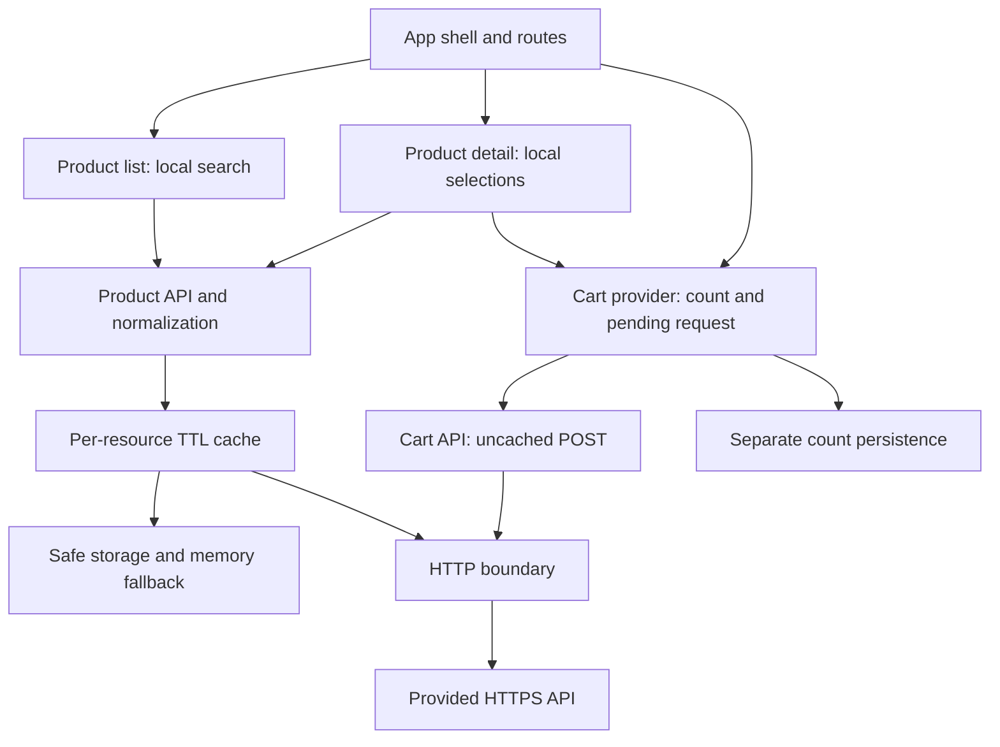

# Design: Mobile-device shopping prototype

## Technical approach and evidence

Build a client-rendered React + TypeScript SPA with Vite, React Router in declarative mode, native `fetch`, a small product cache, and a cart context. This implements the [proposal](proposal.md) and the six [capability specifications](specs/). The source directory was inspected: it contains the PDF and planning documents, with no existing application, conventions, package manifest, or tests to preserve. All paths below are proposed. No implementation, deployment, or remote cart mutation is part of this document.

The PDF mandates two views, React/Preact, API integration, one-hour caching, persisted cart count, scripts, and repository delivery. Framework details, state policies, accessibility safeguards, and tests are selected engineering decisions. Specifications are the behavioral acceptance contract; this document describes implementation. Source requirement IDs and page references live in [exploration.md](exploration.md).

Read-only contract evidence checked on 2026-10-13 is recorded in [`docs/api-contract.md`](../../../../docs/api-contract.md): list fields include string `id`, `brand`, `model`, `price`, and `imgUrl`; one detail GET confirmed actual attribute keys and numeric option-code shape for one product. CORS GET headers and JSON POST preflight headers were also observed. Full catalog variation, not-found/error shapes, browser-engine behavior, cookie/session meaning, and cart response semantics remain unverified. The implementation preserves these limitations and does not send cart mutations during checks.

## Architecture decisions

| Decision | Choice and rationale | Alternatives and tradeoff |
|---|---|---|
| ADR-01 — Frontend | React + strict TypeScript + Vite. React satisfies the brief; TS makes boundary/domain distinctions explicit; Vite supplies a small SPA toolchain. | Preact is valid but adds no necessary benefit here. Plain JS is allowed but loses compile-time checks. SSR/full-stack frameworks add scope inconsistent with this brief. |
| ADR-02 — Routing | React Router declarative `BrowserRouter`, with `/` and `/products/:productId`. Semantic links retain browser behavior. | Hash routes simplify some hosts but change canonical URLs. Framework router/server features are unnecessary for two views. |
| ADR-03 — State | View-local search and selections; app-level cart provider; product API/cache service outside component lifetime. Compute filtered products during render. | Redux/globalizing every field creates unnecessary coupling. Derived search results need no effect or separate synchronized state. |
| ADR-04 — Remote data | Native fetch plus one narrowly scoped, explicitly tested read cache. The exact one-hour behavior remains visible. | Query libraries are useful if complexity grows, but their refetch/persistence defaults require extra control. Revisit if the custom adapter grows beyond these two resource types. |
| ADR-05 — Persistence | Versioned localStorage records with memory-first fallback; distinct namespaces for product cache and cart count. | Memory alone is permitted for cache but misses useful reload reuse. IndexedDB adds async/schema complexity for small JSON payloads. |
| ADR-06 — Validation | Small explicit runtime parsers accepting `unknown`, with typed normalized output and fixtures. Validate identity/structure strictly and presentation values tolerantly. | Type casts do not validate remote data. A schema library is optional if parsers become hard to maintain, not a required dependency. |
| ADR-07 — Styling | CSS Modules for components, a small global reset and token file; native controls. Preserve the PDF layout, use no large UI kit. | A design-system framework or elaborate animation work would dominate this prototype. |
| ADR-08 — Mutation | One pending cart request globally, authoritative count replacement, no optimistic count or automatic POST retry. | Concurrent mutations need ordering/session/idempotency guarantees that the API does not provide in the brief. |
| ADR-09 — Verification | Vitest + Testing Library + MSW for deterministic behavior; Playwright for a compact browser suite against the built app. | Live API tests are unreliable as CI gates and can mutate shared state. Snapshot-only tests miss the meaningful contract. |

Use compatible supported stable package releases at implementation setup, record exact resolution in `package-lock.json`, and record the runtime in `.nvmrc` and `package.json#engines`. Do not claim unverified version pins. The current Vite guide lists Node 20.19+ or 22.12+ as minimums; choose a then-supported Node LTS satisfying all selected tools. See [Vite setup](https://vite.dev/guide/). React Router documents declarative setup with Vite and `BrowserRouter`; use that mode rather than mixing framework instructions into this SPA. See [router installation](https://reactrouter.com/start/declarative/installation).

## Boundaries and data flow



Dependencies point from UI to domain/service boundaries. API and storage modules do not import React. The HTTP layer handles transport, not product semantics. Product normalization handles display fields/options, not rendering. Components receive domain data rather than interpreting arbitrary JSON. Share abstractions only where there is an actual second use; no generic repository framework, dependency injection container, backend, or event bus.

`CartProvider` is mounted above routes so a pending addition survives navigation. The product service/cache instance is also stable across routes and React development remounts. Inject a clock, storage facade, and fetch function into cache/service constructors for focused tests; application startup supplies browser defaults.

## Routes, presentation, and state ownership

| Route/state | Data and behavior | Navigation/focus |
|---|---|---|
| `/` | Pending → ready/empty/error. Ready filters immediately by trimmed lowercase substring in brand OR model separately. Preserve API order; no pagination, debounce, or network search. | Header home/current breadcrumb; search above grid, aligned right when space allows. |
| `/products/:productId` | Pending → ready/unavailable/error. Ready owns selections for that product and displays every required attribute label. | Home/product breadcrumb, explicit link to `/`; route heading focus after navigation. |
| Unknown route | Unavailable state inside the shared shell. No third commerce feature/view. | Home link always usable. |
| Cart mutation | Idle → pending → confirmed or failed/uncertain; count changes only on a valid response. | Shared accessible status; navigation stays enabled. |

Encode an opaque ID once when creating a route/API path segment; use the router's decoded parameter and encode it when constructing the API URL. Do not coerce IDs to numbers, interpolate arbitrary paths, or double-decode. Reject empty/malformed local parameters without creating a malformed request. Do not infer restrictive ID character rules from a single sample.

Set the page title to catalog/product information. Use `header`, breadcrumb `nav` with an ordered list and `aria-current="page"`, `main`, one primary heading, semantic product links, `dl` for attributes, and labeled native selects. The cart badge is informational text, not a link to a nonexistent cart screen. Keep header positioning usable on mobile. Back-to-list is an actual `/` link rather than `history.back()`, so direct PDP entry works.

Grid recommendation: explicit 1/2/3/4-column breakpoints around 480/768/1100 CSS pixels, never an unrestricted auto-fit that could create five columns. Verify 320, 768, and 1280 CSS-pixel viewports; tune breakpoints to content. PDP uses two columns on desktop and image → description → actions order when stacked. Use `minmax(0, 1fr)`, wrapping long values, consistent image aspect ratio and `object-fit: contain`. Search occupies available width on small screens. These numbers are design defaults, not PDF mandates.

Search resets when PLP remounts; URL query persistence is not required. For missing display text use “Not available”; for blank prices use “Price unavailable”. Preserve the supplied price string without adding currency or units. Numeric zero must not be mistaken for missing. Failed images use a stable local placeholder with useful accessible text, without an error-handler retry loop. Multiple camera entries remain distinguishable rather than rendering `[object Object]`.

Selections reset on product identity/data replacement. Key the variant form by the current loaded product identity and initialize only after normalized details are available. A sole valid option is visible and selected; multiple options show a placeholder and require choice. An invalid collection must not be filtered down into a fictitious sole valid option. Show the unavailable reason and disable purchase if either collection is malformed, empty, ambiguous, or lacks valid codes. Empty price alone does not disable purchase. Do not invent variant combination restrictions.

## Interfaces and API contract

Base URL defaults to `https://itx-frontend-test.onrender.com`; an optional documented `VITE_API_BASE_URL` is public configuration, not a secret. Construct paths centrally. A 20-second timeout is the proposed finite default for both reads and mutations; make it a shared constant and test with fake time. Validate in-browser behavior before accepting this default against the service's latency.

| Operation | Source contract | Validation and handling |
|---|---|---|
| `GET /api/product` | JSON array; observed list fields described above. | Require array and nonempty string identity for every item; reject duplicate identities and unsafe identity structure rather than silently dropping products. Missing optional presentation fields become fallbacks. |
| `GET /api/product/:id` | One product object; full schema omitted in PDF. | Require valid identity matching requested ID; normalize observed detail keys after contract validation. A list item is not a full-detail substitute. |
| `POST /api/cart` | JSON `{ id, colorCode, storageCode }` → `{ count }`. | Require successful HTTP status, parseable object, and finite nonnegative safe-integer numeric count. Preserve exact validated option code types. |

Contract examples (illustrative, not claimed live detail/cart observations):

```json
{ "id": "opaque-product-id", "colorCode": 1000, "storageCode": 2000 }
```

```json
{ "count": 3 }
```

Proposed normalized interfaces, to be finalized by the contract-validation task:

```ts
type OptionCode = string | number; // narrow after evidence; never coerce
interface ProductSummary {
  id: string;
  brand: string | null;
  model: string | null;
  priceText: string | null;
  imageUrl: string | null;
}
interface VariantOption { code: OptionCode; label: string }
interface ProductDetail extends ProductSummary {
  attributes: {
    cpu: string | null; ram: string | null; operatingSystem: string | null;
    screenResolution: string | null; battery: string | null;
    cameras: string[]; dimensions: string | null; weight: string | null;
  };
  colors: VariantOption[];
  storages: VariantOption[];
  purchaseUnavailableReason: string | null;
}
interface AddToCartInput {
  id: string; colorCode: OptionCode; storageCode: OptionCode;
}
type ResourceState<T> =
  | { status: 'loading' }
  | { status: 'ready'; data: T }
  | { status: 'unavailable'; message: string }
  | { status: 'error'; message: string };
```

Names such as remote `cpu`, `ram`, `os`, `displayResolution`, `battery`, `primaryCamera`, `secondaryCamera`, `dimensions`, `weight`, and `options.colors/storages` are only candidate mappings to investigate, not contracts. Before implementing the adapter, record representative detail responses, empty-field variants, option labels/codes/types, and camera shapes in `docs/api-contract.md`, plus sanitized representative fixtures in `tests/fixtures/`. If a required attribute is truly absent, retain its label/fallback and document the limitation.

For native `<select>`, HTML values are strings. Use an internal stable option token/index for the control and look up the original validated option object at submit time; the API receives its original code, never the HTML token or index. Check membership immediately before submission. Treat duplicate/ambiguous codes as invalid until a contract rule resolves them.

The HTTP boundary checks `response.ok`, handles JSON parse failures and unexpected structures, and maps errors to safe categories: network, timeout, HTTP failure, invalid response. A resolved fetch does not itself mean HTTP success, as documented in [MDN fetch](https://developer.mozilla.org/en-US/docs/Web/API/Window/fetch). Do not use `mode: 'no-cors'`, invent credentials, or add a proxy to hide a browser CORS blocker. Default browser credential behavior remains unchanged unless evidence requires an explicit supported session policy. Detect not-found through confirmed HTTP semantics; do not fabricate a provider-specific error body.

## Product-cache algorithm

Owned keys: `nunegal:products:v1:<resource>`, where resource is `list` or an encoded detail identity; cart uses `nunegal:cart-count:v1`. Include the configured API origin/base identity in cache key construction to prevent mixing data when environments change.

```ts
interface CacheEntry<T> {
  version: 1;
  fetchedAt: number; // wall-clock ms when validated response succeeds
  data: T;
}
const TTL_MS = 3_600_000;
```

1. At each resource access, inspect memory first, then safely read that resource's persisted record. Validate record version, finite nonnegative timestamp, payload, and matching resource identity. A future timestamp, malformed JSON, unsupported schema, or invalid payload is a miss. Best-effort removal affects only that owned key.
2. Freshness is exactly `0 <= now - fetchedAt && now - fetchedAt < TTL_MS`. Return a fresh validated entry without any GET. Reads never rewrite `fetchedAt` or extend expiry. List and details have separate timestamps; list data never seeds full details.
3. For a miss/expiry, join an existing promise from `inFlightByKey` if present. Otherwise create one bounded GET, store its promise, validate and normalize success, timestamp success, write memory, then best-effort persist. Resolve usable data even if serialization/storage writes fail.
4. Remove the pending map entry in `finally` on success/failure. Failures are not cached as successes. Explicit user retry repeats this same algorithm; there is no automatic retry storm and no bypass of a still-fresh entry.
5. On a new expired-resource access, show loading and then current data or a recoverable error. Do not expose the expired record as current after failed revalidation. Already rendered views need not disappear or refetch on a timer. There are no focus, interval, or reconnect refetches inside the freshness window.
6. Each UI subscription captures its resource key/generation and ignores resolution after unmount or identity change. A request for A may complete and populate A's cache, but cannot replace B's view/breadcrumb. Keep shared GET alive when a single subscriber unmounts; service-owned timeout aborts it. This avoids one consumer canceling another consumer's deduplicated request and keeps Strict Mode remounts safe.
7. Read/write/access to localStorage are wrapped because obtaining or using storage can throw. Successful memory data remains usable for the session. On quota failure, optionally remove expired owned product records once and retry persistence once; never clear all storage, cart state, or unrelated keys. No persistent background eviction process is needed for this small catalog.
8. Invalidate through schema-version change, corrupt/expired entry replacement, or an explicit targeted development helper. Cart addition does not invalidate products. No service worker is introduced. Use fetch `cache: 'no-store'` for product network retrieval so browser HTTP cache does not accidentally extend the application TTL; CDN behavior remains a service concern.

Clock rollback produces a miss rather than indefinite freshness. Cache records are untrusted: revalidate persisted data using the same domain checks before use. Expired records can be lazily removed on access; no unbounded history or duplicate versions should be created intentionally. Cache state is not a security boundary and never stores credentials.

The localStorage API can throw and persistence depends on origin/browser policy; this justifies the best-effort boundary. See [MDN localStorage](https://developer.mozilla.org/en-US/docs/Web/API/Window/localStorage). React documents the need to prevent out-of-order responses from updating current UI when fetching in effects; that cleanup belongs in the resource hook, not every product component. See [React useEffect](https://react.dev/reference/react/useEffect).

## Cart lifecycle and persistence

Initialize the provider once from validated `{ version: 1, count }`; accept zero and any nonnegative safe integer, otherwise use zero. Count has no TTL because the brief supplies no read/synchronization endpoint. It is the last confirmed count for this browser origin, not proof of current server session state. No cross-tab consistency or multi-device cart is promised. A storage error leaves count in memory; README explains reload persistence is then unavailable.

On Add: validate current product/options, acquire a synchronous provider-level pending guard before awaiting, capture input and product label, then issue exactly one POST with JSON and `Content-Type: application/json`. A disabled button alone is insufficient protection against repeated events or another PDP. Keep count unchanged while pending. On a valid success replace count with returned value, including a lower value or zero, update memory immediately, and best-effort persist. Keep chosen options for a deliberate repeat. Release the guard in `finally`.

Do not abort the mutation merely because the PDP unmounts. The provider owns it until response/timeout, so navigation remains safe and success still updates the header. Announce a neutral “Item added” or a message naming captured product A; never place A's confirmation as if it describes newly viewed B. B retains its own selections. All Add controls honor the global pending state.

An explicit failed response preserves count and reports failure. A timeout, disconnect, malformed success body, or invalid count after sending is unconfirmed: “We could not confirm the addition. It may have reached the service; trying again may add another item.” No automatic retries, optimistic increments, persisted mutation queue, invented GET-cart reconciliation, or claims that abort rolled back the server. The visitor can deliberately retry after the request settles. An uncertain POST cannot be repaired by product cache invalidation. Error/session/idempotency behavior must remain a documented limitation until observed.

## Error handling, accessibility, and security

Keep loading/empty/no-match/error states distinct. Read failures expose a retry and retain header/navigation; invalid PDP data never leaves prior purchase controls active. A small app error boundary catches unexpected render failures with a home/reload recovery; expected HTTP errors stay in view state. Show concise messages, not remote HTML, stacks, or raw diagnostics. Development diagnostics may include endpoint category/status, never secrets.

Use labels for search/selects, visible focus, natural tab order, and meaningful link names. Keep required-choice guidance adjacent to disabled Add and associate it with controls; disabling must not hide the reason. Mark content loading with appropriate busy/status semantics. A single polite live region announces additions; errors use suitable alert/status handling without repeated duplicate announcements. On route navigation focus the new heading; do not steal focus for each search change. Verify keyboard, screen-reader announcements, contrast, 200% zoom, and no overflow at 320 CSS pixels. These are practical acceptance checks, not a claim of full accessibility certification. Clear field-linked messages follow [W3C WAI notification guidance](https://www.w3.org/WAI/tutorials/forms/notifications/).

Render remote/persisted strings through React text interpolation; no `dangerouslySetInnerHTML`. Parse image URLs and accept HTTPS sources from the configured service origin by default; add any CDN origin only after contract evidence. Invalid URLs use a local fallback. Validate API base configuration, escape path segments, and do not include secret keys in Vite variables or Git. Avoid analytics and third-party scripts for this prototype. If hosted, use HTTPS and a minimal tested CSP/host security headers compatible with the API/images; host policy must not break CORS. Review dependency advisories before delivery and distinguish actionable runtime issues from irrelevant tooling findings; do not perform blind breaking upgrades.

## Proposed file changes

All listed paths are **new**. No existing source files need migration, replacement, or deletion. Tests live beside behavior or under `tests/` for shared fixtures/browser flows; split modules further only when needed.

| Paths | Responsibility |
|---|---|
| `README.md`, `.gitignore`, `.nvmrc`, `.env.example` | Setup, assumptions, exclusions, runtime, public API configuration. |
| `package.json`, `package-lock.json`, `index.html` | Scripts, dependencies, reproducible resolution, SPA entry. |
| `tsconfig.json` (single strict config covering app, tests and tool configs), `vite.config.ts`, `eslint.config.js` | Strict types, build/test setup, hooks/accessibility lint rules. |
| `src/main.tsx`, `src/app/App.tsx`, `src/app/router.tsx`, `src/app/AppErrorBoundary.tsx` | Bootstrap, providers/error boundary, two routes and unknown-path state. |
| `src/app/AppHeader.tsx` | Shared title, breadcrumb, count, accessible mutation status. |
| `src/features/catalog/model/product.ts`, `normalizeProduct.ts`, `filterProducts.ts` | Domain types, verified payload adapters, pure search. |
| `src/features/catalog/api/productApi.ts` | List/detail endpoint access using the cache. |
| `src/features/catalog/hooks/useProductResource.ts` | Resource states and stale-response protection. |
| `src/features/catalog/pages/ProductListPage.tsx`, `ProductDetailPage.tsx` | View composition and local state. |
| `src/features/catalog/components/ProductCard.tsx`, `ProductAttributes.tsx`, `VariantForm.tsx` | Reusable catalog presentation and selection controls. |
| `src/features/cart/CartProvider.tsx`, `cartApi.ts`, `cartStorage.ts` | Shared mutation/count lifecycle, POST boundary, independent persistence. |
| `src/shared/api/http.ts`, `src/shared/cache/productCache.ts`, `src/shared/storage/safeStorage.ts` | Transport, TTL/inflight behavior, safe persistence. |
| `src/shared/ui/AsyncState.tsx`, `src/shared/ui/ProductImage.tsx` | Shared loading/error presentation and image fallback. |
| `src/styles/tokens.css`, `global.css`, adjacent `*.module.css` | Responsive visual system with small component-local rules. |
| `tests/setup.ts`, `tests/fixtures/`, `tests/mocks/handlers.ts` | Deterministic realistic payloads and MSW handlers. |
| Adjacent `*.test.ts` / `*.test.tsx`, `tests/e2e/shopping.spec.ts`, `playwright.config.ts` | Focused logic/component and critical browser acceptance. |
| `docs/api-contract.md`, `docs/verification-checklist.md` | Dated verified service evidence/unknowns and actual delivery test results. |
| `.github/workflows/ci.yml` or repository-host equivalent | Clean install and required checks; create the selected provider only. |

## Testing strategy and quality gates

Cover the exact named scenarios in the six specs, recording the mapping in the task/traceability plan. Tests assert user-visible behavior or externally meaningful boundary rules, not private functions solely to achieve coverage percentages.

| Layer | High-value coverage | Technique |
|---|---|---|
| Unit | Brand/model matching and whitespace; missing values; option code preservation/zero; invalid identity/options/count; unsafe image URL. | Table-driven parser/filter tests with representative fixtures. |
| Cache unit | First miss, fresh hit, exact 3,599,999/3,600,000 ms boundary, no sliding TTL, separate list/A/B keys, future time, corrupt JSON/schema/data, failed read, denied storage/quota, inflight dedup. | Inject clock/storage/fetch; assert request counts and isolation from cart/unrelated keys. |
| Component/integration | Loading/empty/no-match/error/retry; all attributes; selectors sole/multiple/malformed; pending guard; response count replacement; unknown outcome; route A/B race; navigation during POST. | Testing Library accessible queries and user events; MSW delays/errors; Strict Mode relevant cache test. |
| Browser | Search → PDP → select → Add, exact request body, lower/zero count, reload persistence, TTL access/refetch, failure recovery, direct PDP refresh/history, keyboard path. | Playwright against production preview/server with deterministic network routes, isolated storage per test. |
| Manual | PDF layout match, ≤4 columns, 320/768/1280 widths, zoom, long values, screen reader announcements, focus/contrast/image fallback. | Record viewport/browser and pass/fail evidence in verification document. |
| Live smoke | List/detail GET shape, actual browser CORS/image access; optional later explicitly controlled single cart check. | Separate from deterministic CI; never claim live cart validation from mocked tests. |

Playwright guidance emphasizes testing observable behavior and isolating external dependencies; prefer role/name locators and controlled network data. See [Playwright best practices](https://playwright.dev/docs/best-practices). Keep Chromium critical flows as the routine browser gate, with Firefox/WebKit smoke at delivery when available; document unsupported test environments rather than claiming unrun coverage.

Proposed script contract:

| Script | Command intent |
|---|---|
| `start` | `vite` development server. |
| `build` | `tsc -b && vite build` to type-check and produce `dist/`. |
| `test` | `vitest run` deterministic noninteractive unit/component suite. |
| `lint` | `eslint . --max-warnings 0`. |
| `typecheck` | `tsc -b --pretty false` (same TS configuration as build). |
| `test:watch` | Optional local Vitest watch mode. |
| `test:e2e` | `playwright test` (document/build production assets first). |
| `preview` | `vite preview` for local production verification, not a production host. |

CI uses pinned runtime, `npm ci`, lint/type checks, tests, build, and critical E2E with browser dependencies installed. Cache package downloads, not stale build/test outcomes. Upload browser traces/screenshots only on failure. Fail on meaningful command failures; do not mask failures with permissive shell flags. Public API uptime is not a CI gate. Run a clean checkout rehearsal before handoff.

Performance defaults: load catalog images lazily below the fold, reserve dimensions, keep the primary PDP image eager, use system fonts, avoid icon/font packages for a handful of symbols, and inspect emitted assets for test/server dependencies. Do not prefetch all details. A suggested review target is ≤200 kB gzip of initial application JavaScript excluding remote images, to be measured and adjusted after the first build; it is not a PDF acceptance mandate. Measure local search responsiveness with a realistic complete fixture and inspect mobile layout shifts; public API latency is reported separately, not hidden in unsupported page-speed guarantees. No arbitrary Lighthouse score or coverage percentage blocks delivery without a justified decision.

## Delivery, migration, and rollback

No application/data migration is required. Establish README in the first implementation commit, then commit reviewable milestones aligned with tasks: foundation, boundary/cache, shell/PLP, PDP/options, cart, verification/handoff. Each milestone includes relevant tests and a usable state; avoid one final undifferentiated code dump. Keep generated dependencies/build output and credentials out of Git.

Serve `dist/` using a static host with SPA fallback to `index.html` for application routes, while preserving real asset errors. Test direct `/products/<id>` requests against that serving configuration. If hosted under a subpath, configure Vite base and router basename consistently and recheck images/deep links. Hosting is optional; repository accessibility is the PDF delivery obligation. A host without suitable fallback needs an explicitly documented routing decision rather than a silent broken deployment. Vite describes production build/static deployment and warns that preview is for local verification; see [static deployment](https://vite.dev/guide/static-deploy.html).

Later publication requires the user's destination/authorization; this plan publishes nothing. Verify public read access, meaningful commit history, clean-clone scripts, and README notes on unknown currency/API behavior/storage limitations. If a release fails, restore the last verified static build or revert the relevant milestone. Schema bumps discard incompatible owned product entries without touching cart count. No frontend rollback can undo accepted remote cart mutations.

## Open questions and implementation gates

No unanswered user preference blocks this plan. English UI, neutral branding, npm, and optional static hosting are recommended defaults; English documentation and prototype scope are confirmed. Resolve these technical evidence gaps before dependent implementation/handoff:

1. **Contract gate:** obtain representative detail JSON and verify field names, option shape/code types, cameras, and missing fields; record the result and update fixtures/adapters. Do not implement candidate remote mappings as established facts.
2. **Browser integration gate:** check CORS for list/detail and JSON POST preflight from the local/target origin, allowed image origins, and actual failure statuses. A CORS failure is a service limitation to report, not permission to create an unrequested backend.
3. **Cart evidence:** session/identity, repeated-add behavior, count meaning and error/idempotency guarantees are unspecified. Keep authoritative replacement and uncertainty handling; a real mutation test requires a later controlled decision and must not be part of unattended CI.
4. **Toolchain gate:** resolve current compatible stable versions, supported Node LTS, and record lockfile/runtime. No installation has been done during planning.
5. **Delivery choice:** choose repository owner/provider and optional host when publishing is requested. Currency stays unspecified unless the user or authoritative service contract supplies it.

These gates bound uncertainty without adding speculative commerce functionality or blocking implementation of independent shell, parser-fixture, cache, and UI work.

## Implementation notes (2026-10-13)

These record decisions taken during implementation and verification; behavior still follows the specifications.

- **Content-Security-Policy:** `vite.config.ts` injects a CSP `<meta>` into the production HTML only (the dev server needs inline fast-refresh scripts). It allows `'self'` for scripts and styles, and the configured API origin for `img-src`/`connect-src`. A host should also send the policy as a header and add `frame-ancestors`, which a meta tag cannot carry. WebKit reports a style-src violation for native `<select>` internals; this is a browser artifact and does not affect rendering.
- **Error recovery:** `AppErrorBoundary` is keyed by pathname inside the shell, so navigating away from a failed render clears the failure while the header stays mounted.
- **Focus:** the shell focuses the route `<h1>` after navigation; the PDP restores that focus when its loading heading is replaced. Programmatically focused headings do not draw a focus ring.
- **Timeout:** the shared 20-second timeout is kept after the live check observed a 52-second cold start. The first request against a sleeping service fails with a retry action instead of an open-ended wait (see `docs/api-contract.md`).
- **Not-found:** the live service returns HTTP 500 for unknown ids, so "unavailable" is shown only for a real 404; other failures show the retryable error state.
- **Tests:** page tests stub the `productApi` singleton methods, and integration and browser tests intercept HTTP. Browser tests run on Chromium, Firefox and WebKit against a freshly built preview, with axe-core accessibility scans; CI is defined in `.github/workflows/ci.yml`.
